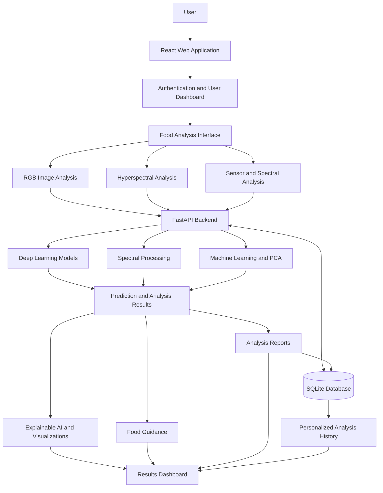
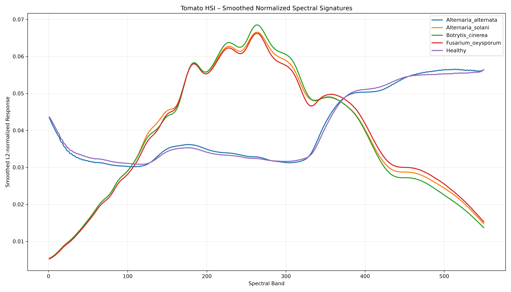
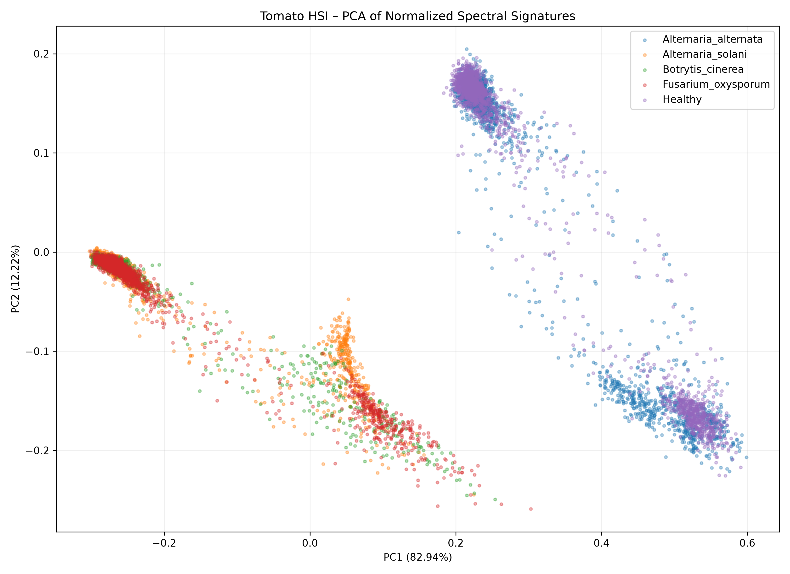
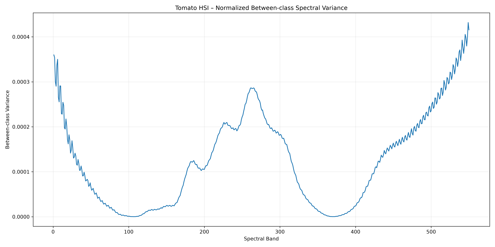
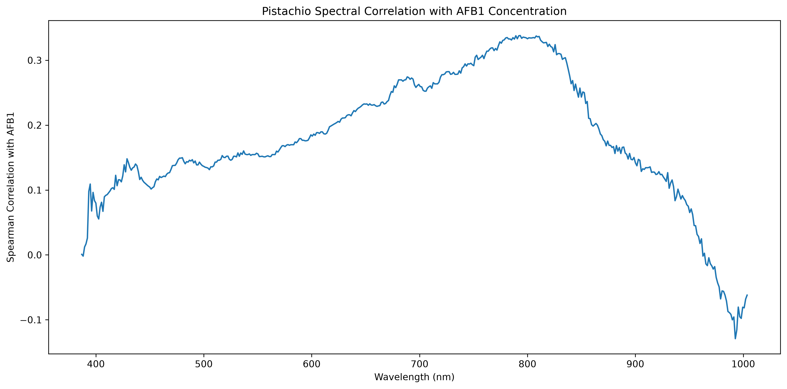
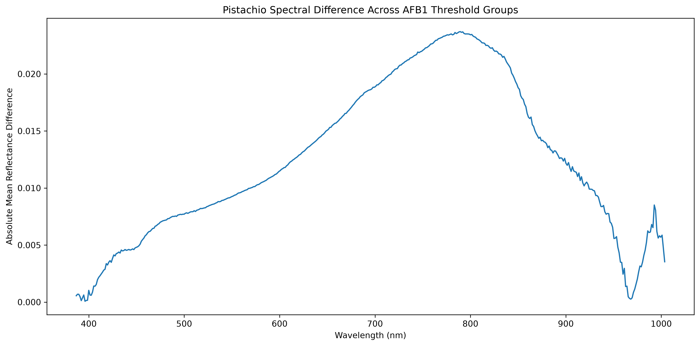
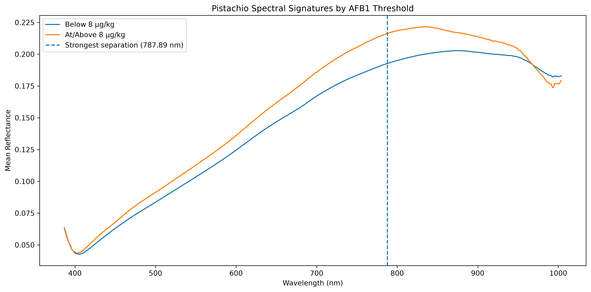
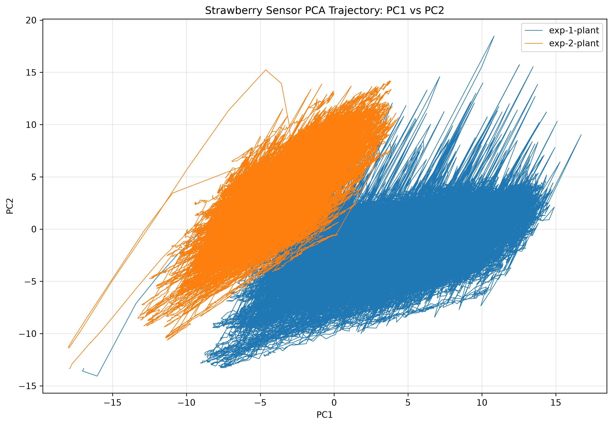
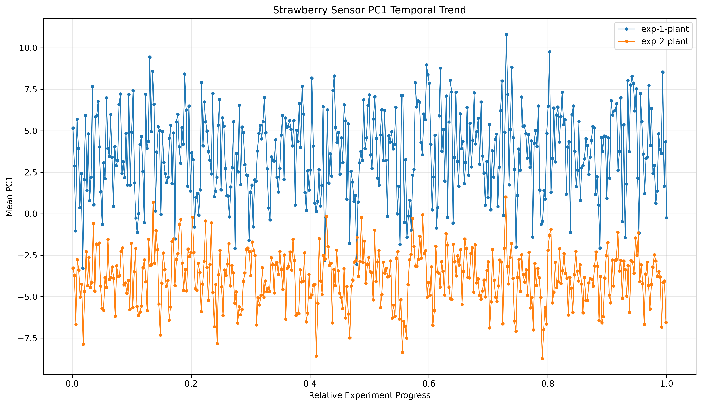
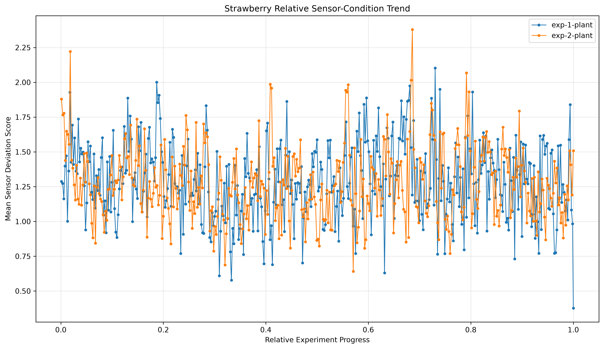

# 🍎 SpectraGuard — AI Food Quality Platform

An intelligent, full-stack food quality assessment platform integrating **Artificial Intelligence, Deep Learning, Computer Vision, Hyperspectral Imaging, Spectral Analysis, and Explainable AI** for food freshness assessment, spoilage detection, and mold-related research.


---

## 📑 Table of Contents

- [Project Overview](#-project-overview)
- [Objectives](#-objectives)
- [Platform Features](#-platform-features)
- [AI and Research Modules](#-ai-and-research-modules)
- [Supported Classes](#-supported-classes)
- [Dataset Information](#-dataset-information)
- [System Architecture](#-system-architecture)
- [Technology Stack](#-technology-stack)
- [Project Structure](#-project-structure)
- [Model Performance](#-model-performance)
- [Key Research Findings](#-key-research-findings)
- [Explainable AI](#-explainable-ai)
- [Results and Visualizations](#-results-and-visualizations)
- [Installation and Setup](#-installation-and-setup)
- [Running the Application](#-running-the-application)
- [Development Status](#-development-status)
- [Future Work](#-future-work)
- [Authors](#-authors)

---

## 📖 Project Overview

Food spoilage contributes significantly to global food waste, economic losses, and food safety concerns. Conventional food quality assessment techniques often depend on manual inspection, laboratory testing, or subjective visual evaluation.

**SpectraGuard** aims to address these challenges by developing an intelligent, accessible, and explainable AI platform for automated food quality assessment.

The platform combines conventional RGB image analysis with advanced hyperspectral and spectral data analysis to investigate food freshness, spoilage, mold contamination, and other quality-related characteristics.

The project integrates multiple machine learning and deep learning approaches within a unified full-stack web application, providing users with predictions, analytical visualizations, food guidance, and personalized analysis history.

SpectraGuard is developed as an interdisciplinary academic research project combining computer science, artificial intelligence, food quality assessment, and sensor-based technologies.

---

## 🎯 Objectives

- Develop an automated AI-powered food quality assessment system.
- Classify fresh and rotten fruits using deep learning.
- Investigate mold contamination through RGB and hyperspectral analysis.
- Identify spectral characteristics associated with food quality.
- Apply dimensionality reduction and machine learning to spectral datasets.
- Provide interpretable predictions using Explainable AI.
- Integrate multiple food analysis modules into a unified web platform.
- Provide users with food guidance and analytical reports.
- Maintain personalized analysis history through secure user accounts.
- Investigate the feasibility of low-cost spectral sensor integration.
- Support future shelf-life estimation and food storage recommendations.
- Contribute towards reducing food waste and improving food quality awareness.

---

## 🚀 Platform Features

### 1. RGB Image Analysis

- Multi-class fruit classification.
- Fresh versus rotten classification.
- CNN-based baseline model.
- MobileNetV2 transfer learning.
- Prediction confidence scores.
- GradCAM-based visual explanations.
- External dataset validation.
- Image-based food quality assessment.

### 2. Hyperspectral and Spectral Analysis

- Hyperspectral data processing.
- Spectral preprocessing and normalization.
- Principal Component Analysis (PCA).
- Spectral signature visualization.
- Between-class spectral variation analysis.
- Food-specific spectral insights.
- Research-oriented mold and contamination assessment.
- Support for multiple spectral datasets and data formats.

### 3. User Authentication

- User registration and login.
- JWT-based authentication.
- Secure password hashing.
- Protected application routes.
- Session management.
- SQLite-based user data storage.

### 4. Personalized User Dashboard

- Centralized access to food analysis modules.
- Personalized analysis records.
- Previous prediction results.
- Freshness analytics.
- Food-specific analytical insights.

### 5. Analysis History

- Storage of previous analysis results.
- Retrieval of user-specific analysis records.
- Historical food quality assessment.
- Analysis result reports.
- Structured presentation of prediction information.

### 6. Food Guidance

- Food-specific quality guidance.
- Freshness-related recommendations.
- Storage-related information.
- Interpretation of analysis results.
- Support for informed food handling decisions.

### 7. Research and Analytical Visualizations

- Spectral signature plots.
- PCA visualizations.
- Temporal trend analysis.
- Feature and wavelength analysis.
- Contamination-related spectral comparisons.
- Research-oriented mold reports.

---

## 🔬 AI and Research Modules

SpectraGuard integrates several food-specific analysis and research components within a common application.

### Module 1 — RGB Freshness Classification

The RGB module evaluates food quality using conventional digital images.

Two deep learning architectures were developed and evaluated:

- Custom Convolutional Neural Network (CNN).
- MobileNetV2 using transfer learning.

MobileNetV2 was selected as the final RGB freshness classification model based on its reported performance.

#### Processing Pipeline

```text
RGB Image Upload
        ↓
Image Preprocessing
        ↓
Image Resizing and Normalization
        ↓
MobileNetV2 Classification
        ↓
Fresh / Rotten Prediction
        ↓
Confidence Score
        ↓
GradCAM Explanation
        ↓
Analysis Result and Food Guidance
```

---

### Module 2 — RGB Mold Research

This module investigates the application of conventional RGB imaging to mold-related food quality assessment.

The research component includes:

- RGB-based mold classification experiments.
- MobileNet-based experimental architectures.
- Model evaluation and performance analysis.
- Research-oriented mold analysis reports.
- Investigation of visible mold characteristics.
- Integration of research findings into the web interface.

RGB imaging primarily captures visible surface characteristics. Detection of mold before visible symptoms requires additional spectral investigation and independent validation.

---

### Module 3 — Papaya Hyperspectral Analysis

The papaya hyperspectral component investigates spectral information associated with food quality and deterioration.

Features include:

- Hyperspectral data processing.
- Spectral feature analysis.
- Food-specific spectral insights.
- Backend analysis API.
- Dedicated frontend visualization component.
- Research-oriented interpretation of spectral characteristics.

---

### Module 4 — Tomato Spectral Analysis

The tomato module investigates spectral differences associated with food quality characteristics.

Features include:

- MATLAB data processing support.
- Spectral smoothing and normalization.
- Principal Component Analysis.
- Between-class spectral variance analysis.
- Spectral signature comparison.
- Dedicated tomato spectral analysis API.
- Interactive presentation of analytical results.

#### Analytical Outputs

- Smoothed and normalized spectral signatures.
- Normalized spectral PCA.
- Between-class spectral variance.

---

### Module 5 — Pistachio Spectral Analysis

The pistachio module investigates spectral characteristics associated with aflatoxin B1 (AFB1) contamination.

Features include:

- Spectral correlation analysis.
- Contamination-related threshold comparisons.
- Spectral signature visualization.
- Research-oriented interpretation of contamination characteristics.

#### Analytical Outputs

- AFB1 spectral correlation.
- Threshold difference visualization.
- Threshold-based spectral signatures.

The module is intended for research and analytical interpretation. It is not a substitute for validated laboratory aflatoxin testing.

---

### Module 6 — Strawberry Sensor Data Analysis

The strawberry module investigates temporal changes in sensor-derived food quality data.

Features include:

- Sensor dataset processing.
- Principal Component Analysis.
- Temporal trend visualization.
- Sensor condition analysis.
- PC1 and PC2 trajectory analysis.
- Dedicated backend API.
- Frontend sensor insights.

A demonstration dataset containing 1,000 data records is included in the repository:

```text
strawberry_demo_1000.csv
```

#### Analytical Outputs

- PC1–PC2 trajectory.
- PC1 temporal trend.
- Sensor condition trend.

---

### Module 7 — Nitrogen Analysis Insights

The nitrogen analysis component provides research-oriented visualization and interpretation of nitrogen-related analytical results.

Features include:

- Dedicated result insights component.
- Presentation of nitrogen-related analytical information.
- Integration with the platform's analysis interface.

---

### Module 8 — RGB Disease Classification (Planned)

An additional RGB disease classification module is planned using the **MangoFruitDDS dataset**.

Proposed features include:

- Healthy fruit classification.
- Fruit disease classification.
- Mold-related classification, subject to dataset label suitability.
- Transfer learning and model evaluation.
- Confidence score generation.
- Explainable AI integration.
- Integration with the existing SpectraGuard platform.

Development is planned after completion and validation of the hyperspectral imaging module.

---

## 🧠 Supported Classes

### RGB Freshness Classification

The existing RGB freshness model supports eight classes:

| Food Type | Fresh Class | Rotten Class |
|---|---|---|
| Apple | Apple Fresh | Apple Rotten |
| Banana | Banana Fresh | Banana Rotten |
| Strawberry | Strawberry Fresh | Strawberry Rotten |
| Tomato | Tomato Fresh | Tomato Rotten |

### Additional Research Components

| Food / Analysis | Research Focus |
|---|---|
| Papaya | Hyperspectral food quality analysis |
| Tomato | Spectral characteristics and quality analysis |
| Pistachio | Aflatoxin-related spectral analysis |
| Strawberry | Sensor-based temporal analysis |
| Nitrogen | Nitrogen-related analytical insights |
| Mango | Disease classification — planned |

---

## 📊 Dataset Information

### Final RGB Dataset Distribution

| Class | Images |
|---|---:|
| Apple Fresh | 2,438 |
| Apple Rotten | 2,925 |
| Banana Fresh | 1,999 |
| Banana Rotten | 2,797 |
| Strawberry Fresh | 1,603 |
| Strawberry Rotten | 1,596 |
| Tomato Fresh | 604 |
| Tomato Rotten | 595 |
| **Total Images** | **14,557** |

### Recorded Dataset Split

| Set | Images | Percentage |
|---|---:|---:|
| Training | 9,934 | 69.55% |
| Validation | 2,176 | 15.23% |
| Testing | 2,174 | 15.22% |
| **Total** | **14,284** | **100%** |

> The recorded dataset distribution and split totals differ by 273 images. The preprocessing and dataset splitting records should be consulted to reconcile this difference.

### Additional Research Datasets

The platform also incorporates research datasets and analytical data associated with:

- RGB mold classification.
- Papaya hyperspectral analysis.
- Tomato spectral analysis.
- Pistachio aflatoxin-related spectral analysis.
- Strawberry sensor analysis.
- Nitrogen-related analysis.

The MangoFruitDDS dataset is planned for future disease classification experiments.

Large datasets are excluded from the GitHub repository to maintain a manageable repository size.

---

## 🏗 System Architecture

SpectraGuard follows a modular full-stack architecture.



### Architectural Layers

| Layer | Responsibility |
|---|---|
| Presentation Layer | React-based user interface |
| Authentication Layer | Registration, login, JWT and protected routes |
| Application Layer | FastAPI endpoints and business logic |
| AI Processing Layer | Deep learning and food classification |
| Spectral Processing Layer | Hyperspectral and sensor data analysis |
| Explainability Layer | GradCAM and analytical visualizations |
| Data Persistence Layer | SQLite and SQLAlchemy |
| Reporting Layer | Analysis reports, history and food guidance |

---

## 🛠 Technology Stack

### Programming Languages

- Python 3.11
- JavaScript
- HTML
- CSS

### Artificial Intelligence and Deep Learning

- TensorFlow
- Keras
- MobileNetV2
- Convolutional Neural Networks
- Transfer Learning
- Scikit-learn

### Computer Vision

- OpenCV
- Pillow
- Image preprocessing and normalization

### Hyperspectral and Scientific Computing

- Spectral Python (SPy)
- NumPy
- Pandas
- SciPy
- Principal Component Analysis (PCA)

### Data Visualization

- Matplotlib
- Seaborn
- Plotly

### Explainable Artificial Intelligence

- GradCAM
- Spectral signature visualization
- PCA-based analytical interpretation
- SHAP — planned

### Frontend

- React.js
- Vite
- JavaScript
- CSS

### Backend

- FastAPI
- Uvicorn
- Pydantic

### Database

- SQLite
- SQLAlchemy

### Authentication and Security

- JSON Web Tokens (JWT)
- Pwdlib password hashing
- Environment-based secret configuration
- Protected application routes

### Development and Research Tools

- Git
- GitHub
- Visual Studio Code
- Jupyter Notebook
- Streamlit — initial research prototype

---

## 📂 Project Structure

The following represents the major directories and selected implementation files.

```text
AI-Food-Quality-Platform/
│
├── backend/
│   ├── main.py
│   ├── database.py
│   ├── auth_router.py
│   ├── auth_security.py
│   ├── auth_passwords.py
│   ├── auth_middleware.py
│   ├── user_models.py
│   ├── analysis_models.py
│   ├── analysis_history_router.py
│   ├── analysis_history_service.py
│   ├── food_guidance.py
│   ├── papaya_hsi_api.py
│   ├── tomato_mat_api.py
│   ├── tomato_spectral_api.py
│   ├── strawberry_sensor_api.py
│   └── rgb_mold_report.py
│
├── frontend/
│   ├── public/
│   │   └── analysis/
│   │       ├── pistachio/
│   │       ├── strawberry/
│   │       └── tomato/
│   │
│   ├── src/
│   │   ├── App.jsx
│   │   ├── main.jsx
│   │   ├── LandingPage.jsx
│   │   ├── Auth.jsx
│   │   ├── ProtectedApp.jsx
│   │   ├── UserDashboard.jsx
│   │   ├── AnalysisHistory.jsx
│   │   ├── AnalysisResultReport.jsx
│   │   ├── FreshnessAnalytics.jsx
│   │   ├── PapayaSpectralInsights.jsx
│   │   ├── TomatoSpectralInsights.jsx
│   │   ├── PistachioSpectralInsights.jsx
│   │   ├── StrawberrySensorInsights.jsx
│   │   ├── NitrogenResultInsights.jsx
│   │   ├── RgbMoldResearchReport.jsx
│   │   ├── authSession.js
│   │   ├── freshnessAnalytics.js
│   │   └── CSS Stylesheets
│   │
│   ├── package.json
│   └── package-lock.json
│
├── datasets/
├── models/
│   └── trained/
├── experiments/
├── scripts/
│   ├── training/
│   ├── preprocessing/
│   └── evaluation/
├── notebooks/
├── outputs/
├── reports/
├── docs/
├── tests/
├── configs/
├── instance/
├── strawberry_demo_1000.csv
├── app.py
├── requirements.txt
├── .gitignore
└── README.md
```

> Large datasets, trained model artifacts, generated outputs, virtual environments, local databases, and confidential environment files may not be present in a fresh GitHub clone because they are excluded through `.gitignore`.

---

## 📈 Model Performance

### Baseline CNN

| Metric | Value |
|---|---:|
| Test Accuracy | 96.78% |
| Weighted F1 Score | 0.97 |
| External Accuracy | 88.06% |

### MobileNetV2 — Final RGB Freshness Model

| Metric | Value |
|---|---:|
| Test Accuracy | 99.17% |
| Validation Accuracy | 98.76% |
| Test Loss | 0.0291 |
| Weighted F1 Score | 0.99 |
| External Accuracy | 88.71% |

### Performance Comparison

| Model | Accuracy | Precision | Recall | F1 Score |
|---|---:|---:|---:|---:|
| Baseline CNN | 96.78% | 96.90% | 96.80% | 97.00% |
| MobileNetV2 | 99.17% | 98.90% | 99.20% | 99.00% |

### External Dataset Validation

| Model | External Accuracy |
|---|---:|
| Baseline CNN | 88.06% |
| MobileNetV2 | 88.71% |

The reported external validation results demonstrate the importance of evaluating AI models beyond their original training datasets.

These performance metrics apply specifically to the RGB freshness classification experiments and should not be interpreted as performance metrics for every SpectraGuard module.

---

## 🔥 Key Research Findings

- MobileNetV2 outperformed the custom CNN on the reported internal test dataset.
- Transfer learning improved test accuracy by 2.39 percentage points.
- Reported ROC-AUC values ranged from 0.999 to 1.000.
- External validation revealed domain shift, particularly for tomato classes.
- GradCAM provided visual explanations of model predictions.
- Spectral analysis provides complementary information beyond conventional RGB images.
- PCA enables dimensionality reduction and visualization of high-dimensional spectral data.
- Temporal sensor analysis provides a method for investigating changes in food quality over time.
- Combining multiple imaging and analytical techniques supports a more comprehensive approach to food quality research.

---

## 🧠 Explainable AI

SpectraGuard incorporates explainability techniques to improve the interpretability of AI-generated predictions.

### GradCAM

Gradient-weighted Class Activation Mapping generates heatmaps highlighting image regions that contribute to deep learning predictions.

Applications include:

- Visual interpretation of model decisions.
- Identification of influential image regions.
- Investigation of model attention.
- Improved transparency of classification results.
- Qualitative assessment of prediction behavior.

GradCAM highlights model-relevant regions but does not independently prove that a region contains mold or disease.

### Spectral Explainability

Spectral analysis components provide additional analytical interpretation through:

- Spectral signature comparison.
- PCA visualization.
- Between-class spectral variance.
- Spectral correlation analysis.
- Threshold-based comparison.
- Temporal sensor trends.

---

## 🌐 Full-Stack Web Application

The current SpectraGuard application uses a **React frontend and FastAPI backend**.

The application integrates AI predictions, spectral research, authentication, database functionality, and personalized analytical reporting.

### Application Components

| Component | Description |
|---|---|
| Landing Page | Introduction to the SpectraGuard platform |
| Authentication | User registration and login |
| User Dashboard | Personalized access to platform features |
| RGB Analysis | Image-based freshness classification |
| Hyperspectral Analysis | Food-specific spectral investigation |
| Sensor Analysis | Sensor-derived food quality insights |
| Freshness Analytics | Presentation of freshness-related information |
| Analysis Reports | Structured presentation of results |
| Analysis History | Access to previous user analyses |
| Food Guidance | Food quality and storage-related information |
| Research Reports | Presentation of experimental findings |

### Initial Streamlit Prototype

The initial research version of the platform was developed using Streamlit.

It supported:

- Fruit image uploads.
- Freshness predictions.
- Confidence scores.
- GradCAM visualizations.

The React and FastAPI application represents the subsequent full-stack development of the project.

---

## 📷 Results and Visualizations

### Original Conceptual System Architecture


### Tomato Spectral Analysis

#### Smoothed and Normalized Spectral Signatures



#### Normalized Spectral PCA



#### Between-Class Spectral Variance



---

### Pistachio Spectral Analysis

#### Aflatoxin B1 Spectral Correlation



#### Threshold Difference Analysis



#### Threshold-Based Spectral Signatures



---

### Strawberry Sensor Analysis

#### PC1–PC2 Trajectory



#### PC1 Temporal Trend



#### Sensor Condition Trend



---

### Additional Research Visualizations

The project also includes research and experimental outputs such as:

- Dataset distribution graphs.
- Dataset splitting visualizations.
- CNN architecture diagrams.
- MobileNetV2 architecture diagrams.
- Training accuracy and loss curves.
- Confusion matrices.
- ROC curves.
- Sample predictions.
- GradCAM heatmaps.
- RGB mold classification reports.

Some generated research outputs are maintained locally and are not included in the GitHub repository.

---

## ⚙ Installation and Setup

### Prerequisites

Ensure the following are installed:

- Python 3.11
- Node.js
- npm
- Git

### Step 1 — Clone the Repository

```bash
git clone https://github.com/Diamaria24/AI-Food-Quality-Platform.git
cd AI-Food-Quality-Platform
```

### Step 2 — Create a Virtual Environment

```bash
python -m venv .venv
```

#### Windows PowerShell

```powershell
.\.venv\Scripts\Activate.ps1
```

#### Linux / macOS

```bash
source .venv/bin/activate
```

### Step 3 — Install Python Dependencies

```bash
python -m pip install --upgrade pip
pip install -r requirements.txt
```

### Step 4 — Configure Environment Variables

Create a `.env` file in the project root.

Generate a secure JWT secret using:

```bash
python -c "import secrets; print(secrets.token_hex(32))"
```

Add the generated value to the `.env` file:

```env
JWT_SECRET_KEY=your_generated_secret_key
```

Replace the placeholder with the generated secret.

Never upload the actual `.env` file to GitHub.

### Step 5 — Install Frontend Dependencies

```bash
cd frontend
npm ci
cd ..
```

### Step 6 — Configure Required Research Artifacts

Obtain the trained AI models and required datasets separately.

Place them in the appropriate project directories according to the model loading and dataset configuration used by the application.

These may include:

```text
models/trained/
datasets/raw/
datasets/processed/
datasets/external/
```

The trained models and large datasets are intentionally excluded from version control.

> Dependency requirements, model paths, environment configuration, and dataset availability should be verified before running the complete platform from a fresh clone.

---

## ▶ Running the Application

The frontend and backend should be started in separate terminals.

### Terminal 1 — FastAPI Backend

From the project root, activate the Python virtual environment.

```powershell
.\.venv\Scripts\Activate.ps1
```

Start the backend:

```bash
python -m uvicorn backend.main:app --reload
```

Default backend URL:

```text
http://localhost:8000
```

FastAPI interactive documentation:

```text
http://localhost:8000/docs
```

### Terminal 2 — React Frontend

```bash
cd frontend
npm run dev
```

Default frontend URL:

```text
http://localhost:5173
```

Open the frontend URL in a web browser.

If a different backend port is configured in the frontend, ensure that both configurations match.

### Running the Initial Streamlit Prototype

If the original Streamlit application and its dependencies are available:

```bash
streamlit run app.py
```

---

## 🔐 Security and Data Management

The platform incorporates the following security and data management mechanisms:

- JWT-based user authentication.
- Password hashing using Pwdlib.
- Environment-based secret key configuration.
- Protected frontend routes.
- User-specific analysis history.
- SQLite-based local data persistence.
- Exclusion of confidential files from version control.

The following files and directories are intentionally excluded from GitHub:

- Environment variables and secret keys.
- Local authentication databases.
- Python virtual environments.
- Node.js dependencies.
- Large datasets.
- Trained model artifacts.
- Generated experimental outputs.
- Development backups.
- Temporary audit reports.

These measures support development-stage security and maintainability. A comprehensive security review is required before production deployment.

---

## 📌 Development Status

| Module | Status |
|---|---|
| Research and Planning | ✅ Completed |
| Development Environment Setup | ✅ Completed |
| RGB Dataset Collection | ✅ Completed |
| RGB Data Preprocessing | ✅ Completed |
| Exploratory Data Analysis | ✅ Completed |
| Baseline CNN | ✅ Completed |
| MobileNetV2 Freshness Model | ✅ Completed |
| RGB External Validation | ✅ Completed |
| GradCAM Explainability | ✅ Implemented |
| Initial Streamlit Prototype | ✅ Implemented |
| React Frontend | ✅ Implemented |
| FastAPI Backend | ✅ Implemented |
| Landing Page | ✅ Implemented |
| User Registration and Login | ✅ Implemented |
| JWT Authentication | ✅ Implemented |
| SQLite Database Integration | ✅ Implemented |
| User Dashboard | ✅ Implemented |
| Analysis History | ✅ Implemented |
| Analysis Result Reports | ✅ Implemented |
| Food Guidance | ✅ Implemented |
| Freshness Analytics | ✅ Implemented |
| RGB Mold Research Component | 🔬 Research Implementation |
| Papaya Hyperspectral Analysis | 🔬 Research Implementation |
| Tomato Spectral Analysis | 🔬 Research Implementation |
| Pistachio Spectral Insights | 🔬 Research Implementation |
| Strawberry Sensor Analysis | 🔬 Research Implementation |
| Nitrogen Analysis Insights | 🔬 Research Implementation |
| Complete Hyperspectral Validation | 🔄 In Progress |
| RGB Disease Classification | 📋 Planned |
| Physical Sensor Integration | 📋 Planned |
| Quantitative Shelf-Life Prediction | 📋 Planned |
| Cloud Deployment | 📋 Planned |

---

## 🚀 Future Work

### Artificial Intelligence and Research

- Complete hyperspectral imaging module validation.
- Investigate early-stage mold detection using spectral data.
- Develop RGB disease classification using MangoFruitDDS.
- Evaluate healthy, diseased, and mold-related classification where supported by dataset annotations.
- Expand the number of supported food categories.
- Improve model generalization across external datasets.
- Investigate additional machine learning and deep learning architectures.
- Integrate SHAP-based explainability.
- Develop quantitative shelf-life prediction models.

### Hardware and Sensor Integration

- Investigate AS7341 multispectral sensor integration.
- Develop low-cost spectral data acquisition prototypes.
- Establish sensor calibration procedures.
- Explore real-time sensor-based food quality monitoring.
- Investigate edge AI deployment.

### Platform Development

- Expand food storage recommendation capabilities.
- Improve analytical reporting and visualization.
- Develop downloadable analysis reports.
- Enhance user experience and accessibility.
- Improve automated testing and documentation.
- Perform end-to-end application validation.
- Implement cloud deployment.
- Explore mobile application development.
- Strengthen production-level security.

---

## ⚠ Research Limitations and Disclaimer

SpectraGuard is an academic research and educational platform.

AI predictions and spectral analysis results depend on:

- Dataset quality.
- Image acquisition conditions.
- Sensor characteristics.
- Model generalization.
- Preprocessing techniques.
- Experimental validation.

The platform is not a certified food safety diagnostic system.

RGB image classification cannot reliably identify invisible microbial contamination. Spectral research results must undergo appropriate validation before being used for practical food safety decisions.

The platform should not be used as the sole basis for determining whether food is safe for consumption.

---

## 👩‍💻 Authors

Developed as part of an interdisciplinary academic AI and Data Science project at **Saintgits College of Engineering, Kerala, India**.

| Team Member |
|---|
| Dia Maria |
| Fidha Shaji |
| Sreelakshmi |
| Nayana James |

---

## 📜 License and Usage

This project is developed primarily for:

- Academic research.
- Educational purposes.
- Artificial Intelligence and Data Science project work.
- Food quality assessment research.
- Experimental machine learning development.

Third-party datasets, libraries, and research resources remain subject to their respective licenses and usage conditions.

A formal software license should be added before unrestricted redistribution or commercial use.

---

## ⭐ Citation

If referencing this project in academic or research work, use the following suggested citation:

```bibtex
@misc{SpectraGuard2026,
  title = {SpectraGuard: AI Food Quality Platform Using
           Deep Learning and Hyperspectral Imaging},
  author = {Dia Maria and Fidha Shaji and
            Sreelakshmi and Nayana James},
  year = {2026},
  howpublished = {\url{https://github.com/Diamaria24/AI-Food-Quality-Platform}},
  note = {Academic Research Project,
          Saintgits College of Engineering}
}
```

---

## ❤️ Acknowledgements

- Saintgits College of Engineering
- Project mentors and faculty members
- TensorFlow and Keras communities
- OpenCV community
- Scikit-learn developers
- Spectral Python developers
- React and Vite communities
- FastAPI developers
- Streamlit community
- Kaggle dataset contributors
- Open-source scientific computing communities
- Researchers contributing to food quality assessment and hyperspectral imaging

---

<div align="center">

### 🍎 SpectraGuard

**Intelligent Food Quality Assessment Through AI and Spectral Technologies**

*Artificial Intelligence • Computer Vision • Hyperspectral Imaging • Explainable AI*

Developed with a focus on research, innovation, and sustainable food quality assessment.

⭐ Star this repository if you find the project useful.

</div>
