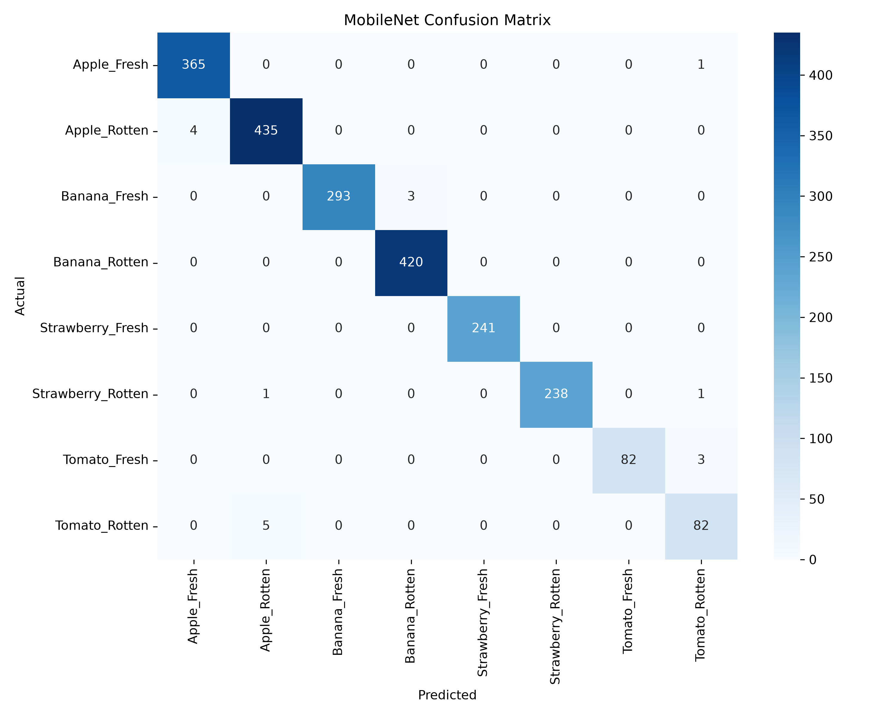

# 🍎 AI Food Quality Platform

An AI-powered platform for food quality assessment using **Deep Learning, Computer Vision, and Hyperspectral Imaging** for freshness estimation, spoilage detection, and early mold identification.

---

## 📖 Project Overview

Food spoilage contributes significantly to global food waste and economic losses. This project aims to develop an intelligent and explainable AI system capable of automatically evaluating food quality using image-based analysis.

The platform currently focuses on **RGB image analysis** and is designed for future integration with **hyperspectral sensors** for early-stage mold detection.

---

## 🎯 Objectives

- Automatic food freshness assessment
- Detection of defective and spoiled produce
- Real-time prediction through a web application
- Explainable AI using GradCAM visualizations
- Future support for hyperspectral imaging and low-cost sensors

---

# 🚀 Features

## RGB Analysis Module

✅ Multi-class Fruit Classification

✅ Fresh vs Rotten Detection

✅ Confidence Score Prediction

✅ Real-Time Web Deployment

✅ Explainable AI (GradCAM)

✅ External Dataset Validation

---

## Future Hyperspectral Module

🔄 Spectral Data Processing

🔄 PCA-based Dimensionality Reduction

🔄 Spectral Signature Visualization

🔄 Early Mold Detection

🔄 Sensor Integration (AS7341)

---

# 🧠 Supported Classes

The RGB module currently supports **8 classes**:

- Apple Fresh
- Apple Rotten
- Banana Fresh
- Banana Rotten
- Strawberry Fresh
- Strawberry Rotten
- Tomato Fresh
- Tomato Rotten

---

# 📊 Dataset Information

## Final RGB Dataset

| Class | Images |
|--------|---------|
| Apple Fresh | 2438 |
| Apple Rotten | 2925 |
| Banana Fresh | 1999 |
| Banana Rotten | 2797 |
| Strawberry Fresh | 1603 |
| Strawberry Rotten | 1596 |
| Tomato Fresh | 604 |
| Tomato Rotten | 595 |
| **Total Images** | **14,557** |

---

## Dataset Split

| Set | Images | Percentage |
|------|---------|------------|
| Training | 9,934 | 69.55% |
| Validation | 2,176 | 15.23% |
| Testing | 2,174 | 15.22% |

---

# 🏗 System Architecture

```text
Input Image
      ↓
Preprocessing
      ↓
CNN / MobileNetV2
      ↓
Prediction
      ↓
GradCAM Explainability
      ↓
Streamlit Deployment
```

---

# 🛠 Tech Stack

## Programming
- Python 3.11

## Deep Learning
- TensorFlow
- Keras
- Scikit-Learn

## Computer Vision
- OpenCV
- Pillow

## Hyperspectral Imaging
- Spectral Python (SPy)

## Visualization
- Matplotlib
- Plotly
- Seaborn

## Explainable AI
- GradCAM
- SHAP (Planned)

## Web Deployment
- Streamlit

---

# 📂 Project Structure

```text
AI-Food-Quality-Platform/
│
├── app.py
├── datasets/
├── models/
│   └── trained/
├── outputs/
│   ├── plots/
│   ├── predictions/
│   └── reports/
├── scripts/
│   ├── training/
│   ├── preprocessing/
│   └── evaluation/
├── notebooks/
├── reports/
├── docs/
├── tests/
├── configs/
└── requirements.txt
```

---

# 📈 Model Performance

## Baseline CNN

| Metric | Value |
|---------|--------|
| Test Accuracy | 96.78% |
| Weighted F1 Score | 0.97 |
| External Accuracy | 88.06% |

---

## MobileNetV2 (Final Model)

| Metric | Value |
|---------|--------|
| Test Accuracy | 99.17% |
| Validation Accuracy | 98.76% |
| Test Loss | 0.0291 |
| Weighted F1 Score | 0.99 |
| External Accuracy | 88.71% |

---

## Performance Comparison

| Model | Accuracy | Precision | Recall | F1 Score |
|--------|-----------|------------|---------|-----------|
| Baseline CNN | 96.78% | 96.90% | 96.80% | 97.00% |
| MobileNetV2 | 99.17% | 98.90% | 99.20% | 99.00% |

---

# 🔥 Key Findings

✅ MobileNetV2 significantly outperformed the custom CNN architecture.

✅ Transfer Learning improved performance by approximately **2.39%**.

✅ Near-perfect ROC-AUC values (**0.999 – 1.000**) were achieved.

✅ External testing revealed domain shift, particularly for tomato classes.

✅ GradCAM improved interpretability and transparency of predictions.

---

# 🧠 Explainable AI

The project incorporates **GradCAM visualizations** to interpret model decisions.

Features:

- Heatmap generation
- Identification of defective regions
- Increased model transparency
- Better trust and interpretability

---

# 🌐 Streamlit Web Application

The deployed web application allows users to:

✅ Upload fruit images

✅ Obtain freshness predictions

✅ View confidence scores

✅ Visualize GradCAM explanations

---

# 📷 Results & Visualizations

- Dataset Distribution Graph
- Dataset Splitting Strategy
- CNN Architecture Diagram
- MobileNetV2 Architecture
- Accuracy/Loss Curves
- Confusion Matrices
- ROC Curves
- Sample Predictions
- GradCAM Heatmaps
- Streamlit Screenshots

---

## Sample Outputs

### Overall System Architecture


### MobileNetV2 Confusion Matrix



---

# 🚀 Future Work

- Hyperspectral Imaging Module
- AS7341 Sensor Integration
- Shelf-Life Prediction
- Storage Recommendation Engine
- Cloud Deployment
- Mobile Application
- Edge AI Deployment

---

# 📌 Development Status

| Module | Status |
|---------|---------|
| Research & Planning | ✅ Completed |
| Environment Setup | ✅ Completed |
| Dataset Collection | ✅ Completed |
| Data Preprocessing | ✅ Completed |
| Exploratory Data Analysis | ✅ Completed |
| Baseline CNN | ✅ Completed |
| MobileNetV2 | ✅ Completed |
| Explainable AI | ✅ Completed |
| Streamlit Deployment | ✅ Completed |
| External Validation | ✅ Completed |
| Hyperspectral Module | 🔄 In Progress |
| Hardware Integration | 🔄 Planned |

---

# ⚙ Installation

```bash
git clone https://github.com/yourusername/AI-Food-Quality-Platform.git

cd AI-Food-Quality-Platform

pip install -r requirements.txt
```

---

# ▶ Running the Application

```bash
streamlit run app.py
```

---

# 👩‍💻 Authors

- Dia Maria
- Fidha Shaji
- Sreelakshmi
- Nayana James

---

# 📜 License

This project is developed for:

- Academic Research
- Educational Purposes
- Software Engineering Project Work

---

# ⭐ Citation

```bibtex
@project{AIFoodQualityPlatform,
  title={AI Food Quality Platform using Deep Learning and Hyperspectral Imaging},
  author={Dia Maria et al.},
  year={2026}
}
```

---

# ❤️ Acknowledgements

- TensorFlow Team
- OpenCV Community
- Kaggle Datasets
- Spectral Python Developers
- Streamlit Team
